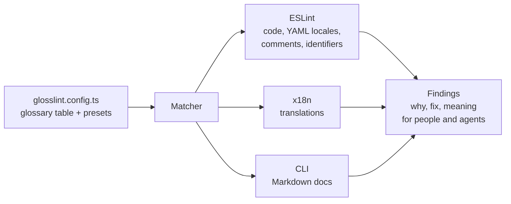

<h1></h1>

<!-- automd:comark-badges packages=glosslint -->

[](https://www.npmjs.com/package/glosslint)
[](https://www.npmjs.com/package/glosslint)
[](https://github.com/onmax/glosslint/actions/workflows/pkg-pr-new.yml)
[](./LICENSE)

<!-- /automd -->

glosslint checks that your product's words are spelled, cased and chosen the way your glossary says. You keep one corpus of terms, each with what it means and which words to avoid. glosslint reports problems in code through ESLint, in translations through x18n, and in Markdown docs through its CLI, with the reason and meaning on every finding so people and coding agents learn the vocabulary as they work.

[Install](#install) · [The corpus](#the-corpus) · [ESLint](#eslint) · [x18n](#x18n) · [CLI](#cli) · [For agents](#for-agents)

## How it works



Every example below uses an invented bike-share app. The full setup lives in [`examples/basic`](./examples/basic).

```diff
  # locales/en.yml
- hint: Return your e-bike to any rack.
+ hint: Return your eBike to any dock.
```

## Install

```sh
pnpm add -D glosslint
```

glosslint needs Node 22.18 or later, because it loads `glosslint.config.ts` with Node's own `import()` and type stripping. ESLint 9.15 or later and `@x18n/core` are optional peer dependencies. Install the ones you use.

## The corpus

The corpus lives in `glosslint.config.ts` at the root of your project. This one extends both presets and a Markdown glossary table, then adds four terms of its own:

```ts
import { defineCorpus, fromGlossaryTable } from "glosslint";
import inclusive from "glosslint/presets/inclusive";
import tech from "glosslint/presets/tech";

export default defineCorpus({
  extends: [tech, inclusive, fromGlossaryTable(new URL("./docs/glossary.md", import.meta.url))],
  terms: [
    {
      term: "Dock",
      description: "A powered stand where one bike is locked.",
      nuance: "A station is a group of docks.",
      avoid: [{ word: "rack", why: "Racks are unpowered." }, "bay"],
      examples: { good: ["Return the bike to any dock"], bad: ["Return the bike to any rack"] },
      links: [{ title: "Docks", url: "https://example.com/docs/docks" }],
    },
    { term: "Checkout" },
    { term: "eBike", case: "exact" },
    { term: "Day Pass", abbr: ["DP"], case: "context" },
  ],
  allow: ["check out our", "roof rack"],
});
```

`defineCorpus` checks every field when the config loads and throws a `GlosslintConfigError` on a mistake, as [Config errors](#config-errors) lists. It returns a flat corpus that ESLint, x18n and the CLI all read.

### Corpus fields

| Field        | What it does                                                                                                                                                                                    |
| ------------ | ----------------------------------------------------------------------------------------------------------------------------------------------------------------------------------------------- |
| `extends`    | Corpora to merge in first: presets, `fromGlossaryTable(…)` or another `defineCorpus(…)`. See [Merge order](#merge-order).                                                                       |
| `terms`      | Your own terms.                                                                                                                                                                                 |
| `allow`      | Phrases that are never reported. A finding that sits inside an allowed phrase is dropped. Words in a phrase match across spaces, hyphens and underscores, and a plural `s` or `es` matches too. |
| `casing`     | The case style of `context` terms per kind of text: `{ label, header, sentence }`. See [Case styles](#case-styles).                                                                             |
| `wholeLabel` | `true` to check every word of a label or header that holds a `context` term, not only the term. See [Case styles](#case-styles).                                                                |

`allow` handles a word that has a second meaning. `rack` is an avoid word for Dock, but "roof rack" is a different thing, so `"roof rack"` goes in `allow`. The same goes for "check out our", which is a verb and not the noun Checkout. To switch off a preset term, allow its spellings.

### Term fields

| Field          | What it does                                                                                                                                                                     |
| -------------- | -------------------------------------------------------------------------------------------------------------------------------------------------------------------------------- |
| `term`         | The term as it should be written, such as `Dock` or `eBike`. Required.                                                                                                           |
| `description`  | What the concept is, in one sentence. Every finding about the term prints it.                                                                                                    |
| `nuance`       | How the term differs from near ones and when not to use it. Every finding's message prints it, and it is the finding's `why` unless an avoid word gives its own reason.          |
| `avoid`        | Words to report in favour of this term. Each is a string, or `{ word, why }` where `why` becomes the finding's reason.                                                           |
| `examples`     | `{ good, bad }`: strings that `glosslint test` expects to pass and to be reported. They are the term's tests.                                                                    |
| `links`        | `[{ title, url }]`, pages that explain the term. The first `url` becomes the finding's `see`.                                                                                    |
| `case`         | How capitals are checked: `exact`, `spelling` (the default) or `context`. See [Casing](#casing).                                                                                 |
| `casing`       | This term's case style per kind of text, over the corpus's `casing`, such as `{ label: "as-written" }`. A term with `casing` and no `case` is a `context` term.                  |
| `abbr`         | Abbreviations of the term, such as `DP` for Day Pass. They are always checked as exact.                                                                                          |
| `skip`         | `["lower"]`, `["upper"]` or both: whole-word casings that always pass. The tech preset sets both, as case-police does, so `github` and `GITHUB` pass while `Github` is reported. |
| `forms`        | Other forms per locale, such as `{ de: ["Dockingstation", "Dockingstationen"] }`. They go to x18n's glossary as they are, and `glosslint explain` finds a term by its forms.     |
| `translations` | The term's translation per locale, such as `{ de: "Dock" }`, passed to x18n's glossary as it is.                                                                                 |

Avoid words match in any case. One with two capitals in a row, such as `SM`, matches only as written. An avoid word with the same key as a term, such as `day-pass` for Day Pass, counts as a misspelling of that term and gives `GLOSSLINT_TERM`, not `GLOSSLINT_AVOID`.

Plurals ending in `s` or `es` match both terms and avoid words. glosslint reports "racks" and suggests "docks".

### Casing

| `case`     | What is reported                                                                                                                                                                                                                    |
| ---------- | ----------------------------------------------------------------------------------------------------------------------------------------------------------------------------------------------------------------------------------- |
| `spelling` | The default. Only splits and hyphens: "Check-out" and "check out" are spelled "Checkout". Capitals are free. The fix keeps the writer's capitals, so "check-out" becomes "checkout".                                                |
| `exact`    | One form everywhere. "E-bike" and "Ebike" are both reported, and the fix is always "eBike".                                                                                                                                         |
| `context`  | Title Case in labels and lowercase in sentences, capitalised at the start of a sentence. A button "Buy a day pass" becomes "Buy a Day Pass", and the sentence "Buy a Day Pass at the kiosk." becomes "Buy a day pass at the kiosk." |

`context` needs to know whether a string is a label, a table header or a sentence. glosslint guesses from the key or attribute name and the text. A string is a header when its name holds `header`, `column`, `col` or `th`, as AG Grid's `headerName` does, and a label when its name holds a word such as `label`, `title`, `button`, `tab` or `heading`, or ends in `name`. Both need at most seven words and no closing period. A string is a sentence when its name holds a word such as `description`, `tooltip`, `text`, `message`, `hint` or `help`, or when it ends in `.`, `!` or `?`. In anything else, comments included, `context` terms get no casing check. In a Vue template, text takes its kind from its element: a `<template #header>` slot is a header and `<h2>` a label. Template text and YAML values that their name doesn't place are labels at four words or fewer with no closing stop, unless they open like a sentence ("There is", "This", "Are you"). Longer ones are labels when they are already in Title Case, and sentences otherwise. Since only the text's shape placed them, a `context` fix there is a suggestion rather than an autofix. In Markdown, headings are labels, a table's first row is headers, and paragraphs and list items are sentences.

The ESLint config and the x18n plugin both take a `kindOf` option that decides first. It gets `{ text, name, file, shown }`, where `name` is the key, attribute or element and `shown` says the text is shown as it is, and returns `"label"`, `"header"`, `"sentence"`, or `undefined` to leave the string to glosslint. Its answer counts as certain, so its fixes are autofixes:

```ts
kindOf: ({ name, file }) => (file?.includes("/charts/") && name === "text" ? "label" : undefined),
```

The name words, sentence openers and Title Case rules are English, so `context` expects English source text.

#### Case styles

`casing` sets how `context` terms are written in labels, headers and sentences. Set it on the corpus for every `context` term, and on a term for that term alone.

| Style        | Day Pass is written                                                             |
| ------------ | ------------------------------------------------------------------------------- |
| `title`      | `Day Pass`. The default in labels and headers.                                  |
| `sentence`   | `day pass`, or `Day pass` at the start of a sentence. The default in sentences. |
| `lower`      | `day pass`                                                                      |
| `upper`      | `DAY PASS`                                                                      |
| `as-written` | As the term is written in the corpus.                                           |

A header takes the label style unless `casing.header` sets its own. Words with an inner capital, such as `eBike`, keep it in every style but `upper`.

By default only the term is checked, so the label "Day pass price" becomes "Day Pass price". With `wholeLabel: true` on the corpus, a label or header that holds a `context` term follows the term's style as a whole when that style is `title` or `upper`: "Day pass price" becomes "Day Pass Price", in one fix that also holds the term's own fix. Small words such as "a" and "of" stay lowercase unless they start the label or follow a dash or colon, and text in parentheses keeps its case.

```ts
export default defineCorpus({
  casing: { header: "upper" },
  terms: [
    { term: "Day Pass", abbr: ["DP"], case: "context" },
    // "Ride history" in labels, "ride history" in sentences, "RIDE HISTORY" in headers.
    { term: "Ride history", casing: { label: "as-written" } },
  ],
});
```

With this corpus, the AG Grid column `{ headerName: "Day pass" }` is reported with the fix `DAY PASS`, and a button "Buy a day pass" still becomes "Buy a Day Pass". In an `upper` header any term written all in capitals passes, abbreviations and `exact` terms too, so `DP` and `EBIKE` are not reported there.

An abbreviation written all in lowercase is not reported, so "dp" in prose passes and "Dp" does not.

### What is never read as words

Before matching, glosslint blanks out text that is code rather than words: `{placeholders}` and `{{ mustaches }}`, ICU syntax, URLs, email addresses, paths, text in backticks, and camelCase, snake_case and kebab-slug tokens. The words inside ICU branches are still read. A token that is an exact term or abbreviation itself stays, so `eBike` is still checked. The `s` of a possessive never forms a word, so "the Dock's light" does not read "s".

### Merge order

glosslint merges terms by key. A key is the term's words joined and lowercased, letters and digits only. "Re-charge point" and "recharge point" share a key.

1. glosslint reads `extends` from left to right. A later corpus replaces an earlier term with the same key. In the config above, a glossary-table term replaces a preset term with the same words.
2. The corpus's own `terms` replace every term from `extends` with the same key. Two of your own terms with the same key throw `GLOSSLINT_C005`.
3. A term is replaced whole. Fields are not merged.
4. `allow` lists add up, every `extends` entry's list first and then your own.

## Glossary table

`fromGlossaryTable(path, columns?)` reads a Markdown table as a corpus, so a glossary page that people already maintain can be the source. Pass a `URL` built from `import.meta.url` to resolve the path from the config file. A plain string resolves from the current folder.

This is [`examples/basic/docs/glossary.md`](./examples/basic/docs/glossary.md):

```md
| Use            | Avoid                                  | Meaning                                        | Notes                                      | Links                                         |
| -------------- | -------------------------------------- | ---------------------------------------------- | ------------------------------------------ | --------------------------------------------- |
| Station        | hub (riders confuse it with the depot) | A group of docks on one street corner.         |                                            | [Stations](https://example.com/docs/stations) |
| Rider          | customer                               | A person with an account who can unlock bikes. | Staff who move bikes are crew, not riders. |                                               |
| Ride           | trip                                   | The time from unlocking a bike to docking it.  |                                            |                                               |
| Week Pass (WP) | weekly ticket                          | Unlimited 30-minute rides for seven days.      |                                            | https://example.com/docs/passes               |
| kiosk          | terminal                               | The screen at a station where you buy passes.  | Always lowercase.                          |                                               |
```

How it is read:

- The reader takes the first table whose header has a `Use` or `Term` column, in any case. It skips tables inside code fences, and stops at the first blank line.
- `Avoid` becomes the avoid list. Commas separate words, and `word (reason)` gives the reason.
- `Description` or `Meaning` becomes `description`, and `Notes` becomes `nuance`.
- Top-level commas in the term cell make several terms. The row's avoid words go to the first one.
- `Week Pass (WP)` gives the term and its abbreviation. Parentheses holding more than single words, such as `Rider (anyone with an account)`, go to the nuance instead.
- A name with an inner capital, such as `eBike`, or all capitals, such as `SOS`, is `exact`. So is a term whose notes say "lowercase".
- Markdown links in any cell, and bare URLs in a `Links` column, become `links`.
- The reader drops backticks, and bold or italic markers around a whole cell. A cell holding only `-` or `—` counts as empty.

Other header names go in the second argument:

```ts
fromGlossaryTable(new URL("./glossary.md", import.meta.url), {
  term: "Word",
  avoid: "Instead of",
  description: "Definition",
  notes: "Usage",
  links: "See",
});
```

A table full of avoid words reports itself, so keep the glossary page out of the paths that `glosslint check` reads.

## Presets

- **`glosslint/presets/tech`**: 477 product and technology names, such as GitHub, iOS, Wi-Fi and Apple Pay, each an `exact` term with `skip: ["lower", "upper"]`. scripts/tech.ts generates it from the dictionaries of [case-police](https://github.com/antfu/case-police) 2.2.1 by Anthony Fu, under the MIT License. The notice is in [NOTICE](./NOTICE). case-police has 488 entries, which make 477 distinct keys. The 7 joined spellings it also accepts, such as `TailwindCSS`, are in the preset's `allow`.
- **`glosslint/presets/inclusive`**: 37 terms for inclusive wording, such as allowlist for "whitelist", staffed for "manned" and placeholder for "dummy data". Each avoid word has a reason and each term has examples. Words that also have a plain technical sense, such as `master` for a git branch, are listed only inside a phrase that pins the meaning, such as "master server".

## ESLint

`glosslint/eslint` returns flat config objects. Spread them into `eslint.config.ts`:

```ts
import glosslint from "glosslint/eslint";
import tseslint from "typescript-eslint";
import vueParser from "vue-eslint-parser";
import * as yamlParser from "yaml-eslint-parser";
import corpus from "./glosslint.config.ts";

export default [
  { files: ["**/*.ts"], languageOptions: { parser: tseslint.parser } },
  {
    files: ["**/*.vue"],
    languageOptions: { parser: vueParser, parserOptions: { parser: tseslint.parser } },
  },
  { files: ["**/*.yml"], languageOptions: { parser: yamlParser } },
  ...glosslint({ corpus, files: ["src/**/*.{ts,vue}", "locales/*.yml"] }),
];
```

glosslint sets no parser. Your config supplies them: typescript-eslint for TypeScript, `vue-eslint-parser` for Vue templates, and `yaml-eslint-parser` for YAML locale files. Plain JavaScript needs none.

ESLint needs `jiti` installed to read `eslint.config.ts`, or the flag `--flag unstable_native_nodejs_ts_config`. An `eslint.config.mjs` with the same contents needs neither, because Node 22.18 imports `./glosslint.config.ts` itself.

### Options

| Option            | Default                                                    | What it does                                                                                                                                                   |
| ----------------- | ---------------------------------------------------------- | -------------------------------------------------------------------------------------------------------------------------------------------------------------- |
| `corpus`          | required                                                   | The corpus, from `import corpus from "./glosslint.config.ts"`.                                                                                                 |
| `files`           | every file                                                 | Globs the rules run on.                                                                                                                                        |
| `ignoreCallees`   | `["endsWith", "startsWith", "includes", "querySelector*"]` | Functions whose first argument is never checked. A trailing `*` matches a prefix. Your list replaces the default. `t`, `$t`, `te` and `tm` are always skipped. |
| `identifierAvoid` | `false`                                                    | Report avoid words in declared names too. Off by default, because a rename touches every caller.                                                               |
| `kindOf`          | none                                                       | Decides a string's kind before glosslint does. See [Casing](#casing).                                                                                          |

The rules themselves take no options. To change a severity, add a config object after the spread, such as `{ rules: { "glosslint/identifier": "off" } }`.

### Rules

| Rule                   | Severity | Reports                                       | Fix                                                          |
| ---------------------- | -------- | --------------------------------------------- | ------------------------------------------------------------ |
| `glosslint/term`       | error    | `GLOSSLINT_TERM`, `GLOSSLINT_CASE` in strings | autofix, or a suggestion where the text's shape set its kind |
| `glosslint/avoid`      | error    | `GLOSSLINT_AVOID` in strings                  | suggestion                                                   |
| `glosslint/comment`    | error    | all three codes in comments                   | autofix for spelling and casing, suggestion for avoid words  |
| `glosslint/identifier` | warn     | how a declared name splits into words         | none: the message names the rename                           |

**`term`** reports a term written with other splits or hyphens, and wrong capitals for `exact`, `context` and abbreviated terms. `eslint --fix` applies the fix and keeps the writer's capitals.

**`avoid`** reports avoid words. It offers the term as an editor suggestion and never autofixes, because someone has to check the meaning first.

`term` and `avoid` read the same places:

- string literals and the text parts of template literals in JS and TS;
- text in Vue templates, and static attribute values;
- YAML string values. Keys are never read.

They skip strings that are code:

- import and export sources, object and class keys, member names, and TypeScript literal types. A quoted object key with a space in it is text, so it is read;
- operands of comparisons and `switch` cases, directives such as `"use strict"`, enum member names, and tagged templates;
- the first argument of `t`, `$t`, `te`, `tm` and of `ignoreCallees`;
- the Vue attributes `class`, `style`, `id`, `key`, `ref`, `name`, `to`, `href`, `src`, `icon`, `type`, `variant`, `color`, `size`, `slot`, `is`, `for`, the `aria-*` attributes that hold ids, and every `data-*`;
- strings with no spaces shaped like code: all lowercase, kebab, snake, camelCase, or a path.

The rules offer a fix only where the source can take it as written. A string whose escapes the fix would break, or a YAML block scalar, gets the finding without a fix.

**`comment`** reads line and block comments, and HTML comments in Vue templates. It reports spellings, avoid words and casing, but only `exact` terms and abbreviations count for casing there. It skips tool directives such as `eslint-disable`, `@ts-expect-error`, `prettier-ignore` and `#region`.

**`identifier`** reads the names of variables, functions, parameters, classes, object properties and class members, and checks how they split into words. With the term Day Pass, `daypassTotal` gets `Rename "daypass" to "dayPass": the term is "Day Pass"`, while `dayPassCount` and `day_pass_id` pass. It keeps the name's style: camel, snake, kebab or SCREAMING_SNAKE. It checks only terms of two or more words and never `exact` terms. It skips shorthand destructuring such as `const { daypass } = response`, because that name came from somewhere else. It offers no fix, because a rename touches every caller.

Each message is one line: the headline, the reason, `Term: description`, the nuance, then `See <url>`. The `messageId` is the finding code, such as `GLOSSLINT_AVOID`.

With the config above, these three files:

```yaml
# locales/en.yml
station:
  title: Buy a day pass
  description: Check-out starts when the dock lets go.
```

```vue
<!-- src/StationCard.vue -->
<template>
  <button title="Buy a Day pass">Find a hub near you</button>
</template>
```

```ts
// src/rides.ts
// Free the rack when the ride ends.
export const endRide = () => "Return your e-bike to any dock.";
export const daypassTotal = 2;
```

give this output from `eslint .`:

```txt
locales/en.yml
  2:16  error  "day pass" is written "Day Pass" in labels  glosslint/term
  3:16  error  "Check-out" is spelled "Checkout"           glosslint/term

src/StationCard.vue
  2:24  error  "Day pass" is written "Day Pass" in labels                                                                                                               glosslint/term
  2:41  error  Use "station" instead of "hub". Riders confuse it with the depot. Station: A group of docks on one street corner. See https://example.com/docs/stations  glosslint/avoid

src/rides.ts
  1:13  error    Use "dock" instead of "rack". Racks are unpowered. Dock: A powered stand where one bike is locked. A station is a group of docks. See https://example.com/docs/docks  glosslint/comment
  2:43  error    "e-bike" is spelled "eBike"                                                                                                                                           glosslint/term
  3:14  warning  Rename "daypass" to "dayPass": the term is "Day Pass"                                                                                                                 glosslint/identifier

✖ 7 problems (6 errors, 1 warning)
  4 errors and 0 warnings potentially fixable with the `--fix` option.
```

`eslint --fix` rewrites the YAML file to `title: Buy a Day Pass` and `description: Checkout starts when the dock lets go.`, and leaves "hub" and "rack" for a person.

## x18n

`glosslint/x18n` is an [x18n](https://github.com/x18n-dev/x18n) plugin. It checks the source locale's messages and the hard-coded strings x18n finds. `toX18nGlossary` turns the corpus into x18n's `glossary`, so translators and machine translation see the same terms:

```ts
// x18n.config.ts
import { defineConfig } from "@x18n/core";
import { toX18nGlossary } from "glosslint";
import glosslint from "glosslint/x18n";
import corpus from "./glosslint.config.ts";

export default defineConfig({
  plugins: [glosslint({ corpus })],
  glossary: toX18nGlossary(corpus),
});
```

| Option         | Default                     | What it does                                                           |
| -------------- | --------------------------- | ---------------------------------------------------------------------- |
| `corpus`       | required                    | The corpus.                                                            |
| `sourceLocale` | the project's source locale | The locale whose messages are checked.                                 |
| `kindOf`       | none                        | Decides a message's kind before glosslint does. See [Casing](#casing). |

The plugin adds three checks:

| Check             | Default severity | Reports           |
| ----------------- | ---------------- | ----------------- |
| `glosslint-term`  | error            | `GLOSSLINT_TERM`  |
| `glosslint-avoid` | warning          | `GLOSSLINT_AVOID` |
| `glosslint-case`  | error            | `GLOSSLINT_CASE`  |

Change one under `checks`, such as `checks: { "glosslint-avoid": "error" }`. A message's key decides label or sentence, as described in [Casing](#casing), and a message whose key doesn't place it is read by its shape. Spelling and casing findings in messages carry a safe fix that `x18n check --fix` applies, except a `context` fix in a message only its shape placed, which is a quick fix you pick. When a message has several, each safe fix applies all of them at once. Avoid words and hard-coded strings get no fix.

`toX18nGlossary(corpus)` gives one entry per term with `term`, `translations` and `forms` as written, a `note` made of the description and nuance, and `doNotTranslate: true` for an `exact` term without translations.

## CLI

The CLI checks what ESLint does not read, such as Markdown docs, and prints the full explanation of each finding. Run it from the folder that holds `glosslint.config.ts`, or pass `--config <path>`. It looks for `glosslint.config.ts`, `.mts`, `.js` and `.mjs`, in that order.

| Command                               | What it does                                                   |
| ------------------------------------- | -------------------------------------------------------------- |
| `glosslint [check] [...paths]`        | Check Markdown and text files. `check` is the default command. |
| `glosslint test`                      | Check every term's good and bad examples.                      |
| `glosslint print [--format md\|json]` | Print the corpus as a Markdown glossary or as JSON.            |
| `glosslint explain <query>`           | Show what the corpus says about a word or phrase.              |

Every command takes `--config <path>`. `check` and `test` take `--color`, which is on by default when writing to a terminal, unless `NO_COLOR` is set.

| Exit code | Meaning                                                                                        |
| --------- | ---------------------------------------------------------------------------------------------- |
| 0         | No findings, every example passes, or `explain` found a term.                                  |
| 1         | `check` found something, a `test` example failed, or `explain` found no term.                  |
| 2         | The config failed to load or is wrong, or the command line is wrong. The error goes to stderr. |

There is no `--fix`. The CLI only reports.

### check

`check` reads files, folders and glob patterns. In a folder it reads `.md`, `.mdx` and `.txt` files, skipping `node_modules` and `.git`. `--ext md,mdx` changes the extensions. `--format json` prints JSON. With no path, it reads the current folder.

In Markdown it skips frontmatter, fenced and inline code, HTML comments and tags, link targets and reference definitions. In MDX it also skips `import` and `export` lines. It reads headings as labels, each table cell on its own, and paragraphs and list items as sentences.

```sh
npx glosslint check docs/guide
```

```txt
[GLOSSLINT_CASE] "day pass" in docs/guide/passes.md:1:12
├▶ fix: Change to "Day Pass": "# Buying a Day Pass"
╰▶ term: Day Pass

[GLOSSLINT_CASE] "Day Pass" in docs/guide/passes.md:3:7
├▶ fix: Change to "day pass": "Buy a day pass at the kiosk, or pay with Apple pay in the app."
╰▶ term: Day Pass

[GLOSSLINT_CASE] "Apple pay" in docs/guide/passes.md:3:42
├▶ fix: Change to "Apple Pay": "Buy a Day Pass at the kiosk, or pay with Apple Pay in the app."
╰▶ term: Apple Pay

[GLOSSLINT_AVOID] "Manned" in docs/guide/passes.md:4:1
├▶ why: It assumes the people on duty are men.
├▶ fix: Use "Staffed": "Staffed stations sell passes from 7:00 to 19:00."
╰▶ term: staffed, having people on duty.

[GLOSSLINT_AVOID] "rack" in docs/guide/riding.md:3:56
├▶ why: Racks are unpowered.
├▶ fix: Use "dock": "Unlock a bike at any station, then return it to a free dock when you finish."
├▶ term: Dock, a powered stand where one bike is locked.
╰▶ see: https://example.com/docs/docks

[GLOSSLINT_TERM] "e-bike" in docs/guide/riding.md:4:15
├▶ fix: Change to "eBike": "Check out our eBike fleet if the hill feels long."
╰▶ term: eBike

6 findings in 2 of 2 files.
```

The heading "Buying a day pass" is a label, so Day Pass takes Title Case there. In the next line it sits inside a sentence, so it takes lowercase. "Check out our" and "roof rack" are in `allow`, and the CLI never reads the code block. Apple Pay comes from the tech preset and "Manned" from the inclusive preset.

### test

`test` checks each term's `examples`. Every `good` string must pass, and every `bad` string must give a finding for that term. Run it in CI and after editing the corpus.

```sh
npx glosslint test | tail -n 3
```

```txt
✓ Dock                    1 good, 1 bad

38 terms, 0 failing.
```

A failing term shows why, and what to change:

```txt
✗ Dock  good example "Return the bike to a dock bay" was flagged:
        "bay" is an avoid word for Dock.
        └ narrow the avoid word or move the example
        bad example "Return the bike to a station" was not flagged.
        └ add the wording to "avoid" or fix the example

1 term, 1 failing.
```

### print

`print` writes the corpus as a Markdown glossary, one section per term that says more than its spelling, and one "Spelling" line for the rest. `--format json` writes `{ terms, allow }`.

```sh
npx glosslint print > .agents/terms.md
```

The Dock section of that file:

```txt
## Dock
A powered stand where one bike is locked.
- A station is a group of docks.
- Don't write: rack (racks are unpowered), bay.
- Good: "Return the bike to any dock". Bad: "Return the bike to any rack".
- See: [Docks](https://example.com/docs/docks).
```

### explain

`explain` finds the term a word belongs to. The word may be the term itself, an abbreviation, a form, an avoid word, a misspelling, or a mention.

```sh
npx glosslint explain rack
```

```txt
Dock
  "rack" is an avoid word for Dock. Racks are unpowered.
  A powered stand where one bike is locked.
  A station is a group of docks.
  Avoid: rack (racks are unpowered), bay.
  Good: "Return the bike to any dock". Bad: "Return the bike to any rack".
  See: Docks https://example.com/docs/docks
  Related: Station
```

```sh
npx glosslint explain e-bike
```

```txt
eBike
  "e-bike" is spelled "eBike".
  Always written "eBike".
```

A word the corpus does not know prints `No term in the corpus matches "scooter".` and exits 1.

## Findings

`glosslint check --format json` prints `{ findings, summary }`:

```sh
npx glosslint check docs/guide/riding.md --format json
```

```json
{
  "findings": [
    {
      "code": "GLOSSLINT_AVOID",
      "file": "docs/guide/riding.md",
      "line": 3,
      "column": 56,
      "start": 71,
      "end": 75,
      "text": "rack",
      "message": "Use \"dock\" instead of \"rack\". Racks are unpowered. Dock: A powered stand where one bike is locked. A station is a group of docks. See https://example.com/docs/docks",
      "why": "Racks are unpowered.",
      "fix": {
        "kind": "suggestion",
        "replace": "dock",
        "result": "Unlock a bike at any station, then return it to a free dock when you finish."
      },
      "term": {
        "term": "Dock",
        "description": "A powered stand where one bike is locked.",
        "nuance": "A station is a group of docks."
      },
      "see": "https://example.com/docs/docks"
    },
    {
      "code": "GLOSSLINT_TERM",
      "file": "docs/guide/riding.md",
      "line": 4,
      "column": 15,
      "start": 107,
      "end": 113,
      "text": "e-bike",
      "message": "\"e-bike\" is spelled \"eBike\".",
      "fix": {
        "kind": "autofix",
        "replace": "eBike",
        "result": "Check out our eBike fleet if the hill feels long."
      },
      "term": {
        "term": "eBike"
      }
    }
  ],
  "summary": {
    "files": 1,
    "findings": 2,
    "GLOSSLINT_TERM": 1,
    "GLOSSLINT_AVOID": 1,
    "GLOSSLINT_CASE": 0
  }
}
```

| Field                    | Meaning                                                                                                                 |
| ------------------------ | ----------------------------------------------------------------------------------------------------------------------- |
| `code`                   | `GLOSSLINT_TERM` for other splits or hyphens, `GLOSSLINT_AVOID` for an avoid word, `GLOSSLINT_CASE` for wrong capitals. |
| `file`, `line`, `column` | Where the text starts. `line` and `column` count from 1.                                                                |
| `start`, `end`           | Offsets of the text in the file.                                                                                        |
| `text`                   | The reported text, as written.                                                                                          |
| `message`                | The one-line message ESLint prints.                                                                                     |
| `why`                    | The avoid word's reason, or the term's nuance. Absent when there is neither.                                            |
| `fix.kind`               | What the fix may do. See below.                                                                                         |
| `fix.replace`            | The text that replaces `text`.                                                                                          |
| `fix.result`             | The line as it reads once fixed.                                                                                        |
| `term`                   | The term's `term`, `description` and `nuance`.                                                                          |
| `see`                    | The term's first link.                                                                                                  |

`fix.kind` is one of:

- `autofix`: a spelling or casing fix. It is safe to apply without asking. ESLint and x18n offer it as a suggestion instead when only the text's shape decided its kind, as described in [Casing](#casing).
- `suggestion`: the term to use instead of an avoid word. Someone has to check that the meaning fits.
- `rename`: a new name for an identifier. It touches every caller, so nothing applies it alone.

In code, `createMatcher(corpus).check(text, kind)` returns the findings for one string. They have the same shape without `file`, `line`, `column` and `fix.result`, and `term` is the whole term. `formatFindings` prints them in the tree format above.

## Config errors

A wrong config fails at load time with a code, the reason and the fix. The CLI prints it and exits 2:

```txt
[GLOSSLINT_C001] Unknown field "avoids" in term "Dock".
├▶ fix: Rename it to "avoid".
╰▶ config: bad.config.ts
```

In code, the error is a `GlosslintConfigError` with `code`, `why`, `fix` and `term`. `CONFIG_ERRORS` exports the corpus codes.

| Code                          | Meaning                                                                                 |
| ----------------------------- | --------------------------------------------------------------------------------------- |
| `GLOSSLINT_C001`              | Unknown field. The fix names the closest field when there is one.                       |
| `GLOSSLINT_C002`              | A term has no `term`, or it holds no letters or digits.                                 |
| `GLOSSLINT_C003`              | `case` is not `exact`, `spelling` or `context`.                                         |
| `GLOSSLINT_C004`              | An avoid word is the term itself. To require one casing, use `case: "exact"`.           |
| `GLOSSLINT_C005`              | Two of your terms have the same key.                                                    |
| `GLOSSLINT_C006`              | `skip` holds something other than `lower` or `upper`.                                   |
| `GLOSSLINT_C007`              | A field has the wrong type, such as `abbr: "DP"`.                                       |
| `GLOSSLINT_C008`              | An `extends` entry is not a corpus, or the config's default export is not one.          |
| `GLOSSLINT_C009`              | The CLI found no config, or `--config` names a file that does not exist.                |
| `GLOSSLINT_C010`              | The config threw while loading, such as on a syntax error.                              |
| `GLOSSLINT_C011`              | `casing` names a kind other than `label`, `header` or `sentence`, or an unknown style.  |
| `GLOSSLINT_NO_GLOSSARY_TABLE` | `fromGlossaryTable` found no table with a term column.                                  |
| `GLOSSLINT_DUPLICATE_TERM`    | `fromGlossaryTable` read the same term twice.                                           |
| `GLOSSLINT_USAGE`             | The command line is wrong, such as an unknown `--format` or a path that does not exist. |

## For agents

To set a project up for coding agents, put the glossary where they read it. `glosslint print > .agents/terms.md` writes it as Markdown. Link that file from `AGENTS.md`, or paste the sections you care about into `AGENTS.md` itself. Rerun the command when the corpus changes. If the project already keeps a glossary table that `fromGlossaryTable` reads, link the table instead.

If you are an agent working in such a project:

1. Read the glossary before you write user-facing text.
2. When you are unsure which word to use, run `glosslint explain "<word>"` first. It prints the term, what it means, the nuance and the words to avoid.
3. After editing, run the project's lint, and `glosslint check --format json` on the docs you touched.
4. Apply findings by `fix.kind`:
   - `autofix`: apply it as given.
   - `suggestion`: read the term's `nuance` and the finding's `why`, then pick the word that fits the meaning. The suggested term is often right. Not always.
   - `rename`: do not apply it alone. Rename every caller in the same change, or report it.
5. After editing the corpus, run `glosslint test`.

## License

MIT. The tech preset includes data from case-police, also MIT. See [NOTICE](./NOTICE).
