<h1></h1>

<!-- automd:comark-badges packages=glosslint -->

[](https://www.npmjs.com/package/glosslint)
[](https://www.npmjs.com/package/glosslint)
[](https://github.com/onmax/glosslint/actions/workflows/pkg-pr-new.yml)
[](./LICENSE)

<!-- /automd -->

[](https://glosslint.onmax.me)

glosslint checks your product's vocabulary against one Markdown file, `.agents/glossary.md`. People and coding agents read that file directly, while ESLint, Oxlint, x18n and the CLI enforce it on code, translations and docs. Every finding carries the reason and meaning alongside the fix.

[Docs](https://glosslint.onmax.me) · [Installation](https://glosslint.onmax.me/guide/installation) · [The glossary file](https://glosslint.onmax.me/guide/glossary) · [ESLint](https://glosslint.onmax.me/integrations/eslint) · [Oxlint](https://glosslint.onmax.me/integrations/oxlint) · [x18n](https://glosslint.onmax.me/integrations/x18n) · [CLI](https://glosslint.onmax.me/integrations/cli) · [For agents](https://glosslint.onmax.me/guide/agents)

## The glossary

Write your product's terms in `.agents/glossary.md`. This excerpt comes from the bike-share app in [`examples/basic/.agents/glossary.md`](https://github.com/onmax/glosslint/blob/main/examples/basic/.agents/glossary.md):

<!-- prettier-ignore -->
```md
# Glossary

The words the rider app and the help center use.

Extends: tech, inclusive
Allow: check out our, roof rack

## Dock
What: A powered stand where one bike is locked.
How: A station is a group of docks.
Avoid:
- rack: Racks are unpowered.
- bay
Good:
- Return the bike to any dock
Bad:
- Return the bike to any rack
Links:
- [Docks](https://example.com/docs/docks)

## eBike

## Day Pass (DP)
Case: context
```

`eBike` gets `Case: exact` automatically because of its inner capital. `Day Pass (DP)` sets the abbreviation `DP` and enforces Title Case in labels and lowercase in sentences. Every runner reads `.agents/glossary.md` by default; `defineCorpus` in `glosslint.config.ts` is available when you need fields such as `skip`, `forms` or `translations`.

## Install

```sh
pnpm add -D glosslint
```

glosslint requires Node 22.18 or later. ESLint (`>=9.15.0`), Oxlint (`>=1.94.0`) and `@x18n/core` (`>=0.1.14`) are optional peer dependencies. Install only the ones you use.

## One finding

Run the CLI on Markdown docs:

```sh
npx glosslint check docs/guide
```

Here is one finding from `examples/basic`:

```txt
[GLOSSLINT_AVOID] "rack" in docs/guide/riding.md:3:56
├▶ why: Racks are unpowered.
├▶ fix: Use "dock": "Unlock a bike at any station, then return it to a free dock when you finish."
├▶ term: Dock, a powered stand where one bike is locked.
╰▶ see: https://example.com/docs/docks
```

## Where it checks

- [ESLint](https://glosslint.onmax.me/integrations/eslint): `glosslint()` reads `.agents/glossary.md` with no options and checks strings, comments and identifiers in JavaScript, TypeScript and Vue templates, plus YAML locale values.
- [Oxlint](https://glosslint.onmax.me/integrations/oxlint): add `"glosslint/oxlint"` to `jsPlugins` in `.oxlintrc.json` to run the four rules on JavaScript, TypeScript and Vue `<script>` blocks (Oxlint JS plugins are alpha).
- [x18n](https://glosslint.onmax.me/integrations/x18n): check source-locale messages and hard-coded strings, and pass the corpus to `toX18nGlossary` for x18n's glossary.
- [CLI](https://glosslint.onmax.me/integrations/cli): checks Markdown, MDX and text files, tests term examples, prints corpora and explains words from the terminal.

## Doctor

`glosslint doctor` checks `.agents/glossary.md` for format mistakes, bad values, duplicate terms and failing `Good`/`Bad` examples. Pass `--fix` to rewrite fixable layout, heading and field-name issues into canonical form without dropping text:

```sh
npx glosslint doctor --fix
```

## For agents

Coding agents read `.agents/glossary.md` directly, so link it from `AGENTS.md`. When an agent is unsure which word to use, `glosslint explain "<word>"` prints the term, its meaning, its usage notes and the words to avoid. [For agents](https://glosslint.onmax.me/guide/agents) covers the editing loop by `fix.kind`.

## License

MIT. The tech preset includes data from case-police, also MIT. See [NOTICE](./NOTICE).
