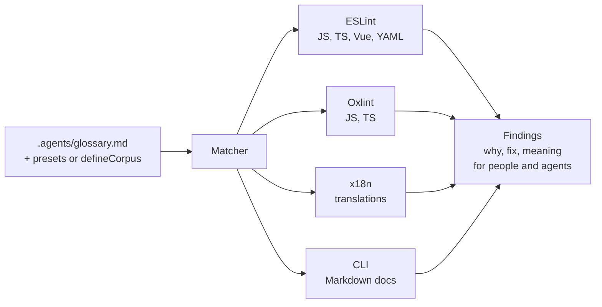

This page explains what glosslint checks, how its pieces connect, and where to go next in the guide. Read it first if you are evaluating glosslint or setting up a product glossary for your repository.

## Why one glossary

Product terms drift across a codebase. A button says `Buy a day pass`, a YAML locale file says `Check-out`, a code comment says `rack` instead of `dock`, and a Markdown guide writes `e-bike`. People who are new to the project, and coding agents working from a prompt, do not know which word the product uses or why another word is wrong.

glosslint keeps your product's words in one Markdown file, `.agents/glossary.md`. Each term holds its spelling, its casing rules, what the concept means, how it differs from nearby concepts, why the project uses it, and which words to avoid. You can also extend the built-in `tech` and `inclusive` presets on one line, or compose the file inside `defineCorpus` in `glosslint.config.ts` when you need TypeScript-only options.

Every finding prints the reason and the term's meaning alongside the fix. People learn the product vocabulary while they fix lint errors, and coding agents read `.agents/glossary.md` directly and get enough context on each finding to decide whether a suggested word fits the sentence.

## Three kinds of finding

Every runner reports the same three finding codes:

| Code | What it reports |
| --- | --- |
| `GLOSSLINT_TERM` | A term written with other splits or hyphens, such as `e-bike` for `eBike` or `Check-out` for `Checkout`. An avoid word with the same key as a term, such as `day-pass` for `Day Pass`, also reports `GLOSSLINT_TERM`. |
| `GLOSSLINT_AVOID` | An avoid word used in place of a term, such as `rack` instead of `Dock`. Its finding prints the reason why and offers a suggestion rather than an autofix. |
| `GLOSSLINT_CASE` | Wrong capitals on an `exact` term, a `context` term, or an abbreviation, such as `day pass` in a label or `Day Pass` inside a sentence. |

See [Findings](/reference/findings) for the full structure of a finding, its JSON output, and the three `fix.kind` values.

## How it works

`readGlossary` parses `.agents/glossary.md` into a validated flat corpus. One matcher checks text against that corpus, and [ESLint](/integrations/eslint), [Oxlint](/integrations/oxlint), [x18n](/integrations/x18n), and the [CLI](/integrations/cli) each feed it the text they own.

Every example in these docs uses an invented bike-share app with terms like `Dock`, `eBike`, `Day Pass`, `Station`, and `Checkout`. The complete working example lives in [`examples/basic`](https://github.com/onmax/glosslint/blob/main/examples/basic).

## Guide pages

- [Installation](/guide/installation): install glosslint, check the Node 22.18 requirement, write `.agents/glossary.md`, and run `check` and `doctor`.
- [The glossary file](/guide/glossary): learn the `.agents/glossary.md` format, corpus and term fields, casing inference, `glosslint doctor --fix`, and migrating from 0.0.1.
- [defineCorpus](/guide/corpus): use `glosslint.config.ts` and `extends: [fromGlossary()]` when you need `skip`, `forms`, `translations`, per-term `casing`, or `wholeLabel`.
- [Defining terms](/guide/terms): configure descriptions, usage notes, reasons, avoid words, examples, links, abbreviations, forms, and translations.
- [Casing rules](/guide/casing): choose between `spelling`, `exact`, and `context` casing, set case styles per text kind, and override detection with `kindOf`.
- [What glosslint skips](/guide/ignored-text): see which placeholders, ICU syntax, URLs, paths, backticks, and code tokens glosslint blanks out before matching.
- [Built-in presets](/guide/presets): extend the built-in `tech` and `inclusive` presets and override or allow individual terms.
- [Coming from case-police](/guide/case-police): see how glosslint uses the case-police dictionaries in the `tech` preset.
- [Coding agents](/guide/agents): link `.agents/glossary.md` from `AGENTS.md` and follow the agent workflow by `fix.kind`.
