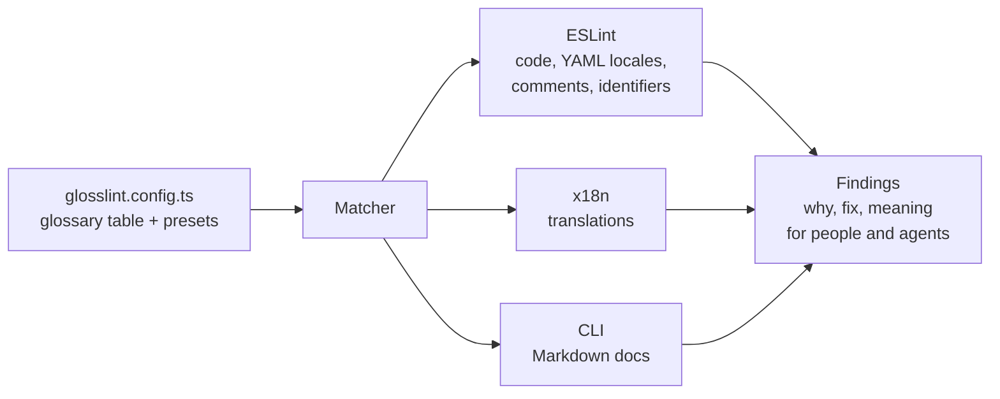

This page explains what glosslint checks, how its pieces connect, and where to go next in the guide. Read it first if you are evaluating glosslint or setting up a product glossary for your repository.

## Why one glossary

Product terms drift across a codebase. A button says `Buy a day pass`, a YAML locale file says `Check-out`, a code comment says `rack` instead of `dock`, and a Markdown guide writes `e-bike`. People who are new to the project, and coding agents working from a prompt, do not know which word the product uses or why another word is wrong.

glosslint keeps one corpus of your product's words in `glosslint.config.ts`. Each term holds its spelling, its casing rules, what the concept means, how it differs from nearby concepts, and which words to avoid. You can also load terms from a Markdown glossary table or extend the built-in tech and inclusive presets.

Every finding prints the reason and the term's meaning alongside the fix. People learn the product vocabulary while they fix lint errors, and coding agents get enough context to decide whether a suggested word fits the sentence.

## Three kinds of finding

Every tool reports the same three finding codes:

| Code | What it reports |
| --- | --- |
| `GLOSSLINT_TERM` | A term written with other splits or hyphens, such as `e-bike` for `eBike` or `Check-out` for `Checkout`. An avoid word with the same key as a term, such as `day-pass` for `Day Pass`, also reports `GLOSSLINT_TERM`. |
| `GLOSSLINT_AVOID` | An avoid word used in place of a term, such as `rack` instead of `Dock`. Its finding prints the reason why and offers a suggestion rather than an autofix. |
| `GLOSSLINT_CASE` | Wrong capitals on an `exact` term, a `context` term, or an abbreviation, such as `day pass` in a label or `Day Pass` inside a sentence. |

See [Findings](/reference/findings) for the full structure of a finding, its JSON output, and the three `fix.kind` values.

## How it works

`defineCorpus` validates your config at load time and returns a flat corpus. One matcher checks text against that corpus, and [ESLint](/integrations/eslint), [x18n](/integrations/x18n) and the [CLI](/integrations/cli) each feed it the text they own.

Every example in these docs uses an invented bike-share app with terms like `Dock`, `eBike`, `Day Pass`, `Station` and `Checkout`. The complete working example lives in [`examples/basic`](https://github.com/onmax/glosslint/blob/main/examples/basic).

## Guide pages

- [Installation](/guide/installation): install glosslint, check the Node 22.18 requirement, write a starter config, and run your first check and corpus test.
- [The corpus](/guide/corpus): configure `glosslint.config.ts`, allow phrases that have a second meaning, and understand merge order across `extends`.
- [Terms](/guide/terms): define each term's spelling, description, nuance, avoid words, examples, links, abbreviations, forms and translations.
- [Casing](/guide/casing): choose between `spelling`, `exact` and `context` casing, set case styles per text kind, and override detection with `kindOf`.
- [Ignored text](/guide/ignored-text): see which placeholders, ICU syntax, URLs, paths, backticks and code tokens glosslint blanks out before matching.
- [Glossary table](/guide/glossary-table): load terms from a Markdown table with `fromGlossaryTable` and map custom column headers.
- [Presets](/guide/presets): extend the built-in `tech` and `inclusive` presets and override or allow individual terms.
- [case-police](/guide/case-police): see how glosslint uses the case-police dictionaries in the `tech` preset.
- [Coding agents](/guide/agents): generate `.agents/terms.md` for `AGENTS.md` and follow the five-step agent workflow.
