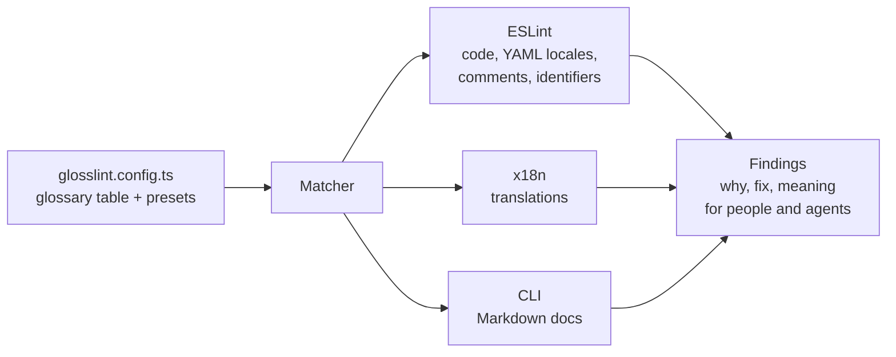

::glosslint-hero
# Lint your product's words from one glossary

glosslint checks that your product's words are spelled, cased and chosen the way your glossary says. You keep one corpus of terms, and glosslint reports problems in code, translations and Markdown docs with the reason and meaning on every finding.
::

:badge{source="github-actions" repository="onmax/glosslint" workflow="pkg-pr-new.yml" icon="github"} :badge[MIT]{label="license"}

## One glossary across code, translations and docs

You keep one corpus in `glosslint.config.ts`, extended with a Markdown glossary table or the built-in tech and inclusive presets when you want them. Three runners read that corpus:

- [ESLint](/integrations/eslint) checks string literals, template literals, Vue templates and static attributes, YAML locale values, comments, and declared identifier names in JavaScript and TypeScript.
- [x18n](/integrations/x18n) checks your source locale's messages and hard-coded strings, and `toX18nGlossary` turns your corpus into x18n's glossary so translators and machine translation see the same terms.
- [CLI](/integrations/cli) checks Markdown, MDX and text files, runs tests against each term's good and bad examples, prints the corpus as Markdown or JSON, and explains any word from the terminal.

## How it works

One corpus feeds one matcher. ESLint, x18n and the CLI each send text to that matcher and report its findings in the format that fits the tool.



## What a check catches

Every example in these docs uses an invented bike-share app whose full setup lives in [`examples/basic`](https://github.com/onmax/glosslint/blob/main/examples/basic). In that app, `eBike` is an exact term and `rack` is an avoid word for `Dock` because racks are unpowered.

```diff
  # locales/en.yml
- hint: Return your e-bike to any rack.
+ hint: Return your eBike to any dock.
```

glosslint reports `e-bike` as a spelling error with an autofix to `eBike`. It reports `rack` as an avoid word with a suggestion to use `dock`, the reason why, the definition of `Dock`, its nuance against `Station`, and a link to the docks page.

## Findings built for people and coding agents

Every finding carries the code, the location, the reason why, the term's description and nuance, a link for more reading, and a `fix` tagged by kind. Spelling and casing fixes are marked `autofix` when the text's kind is known. Avoid words are marked `suggestion` so a person or agent reads the meaning before changing the wording. Identifier splits are marked `rename` and never applied on their own because a rename touches every caller.

Read [Findings](/reference/findings) for the full JSON shape and fix rules, or [Coding agents](/guide/agents) to wire your glossary into `AGENTS.md` and an agent editing loop.

## Install

```sh
pnpm add -D glosslint
```

glosslint needs Node 22.18 or later, because it loads `glosslint.config.ts` with Node's own `import()` and type stripping. ESLint 9.15 or later and `@x18n/core` are optional peer dependencies, so install only the ones you use.

Follow [Installation](/guide/installation) for npm, yarn and bun commands and a first setup, or start with the [Guide](/guide) to see how the corpus works.
