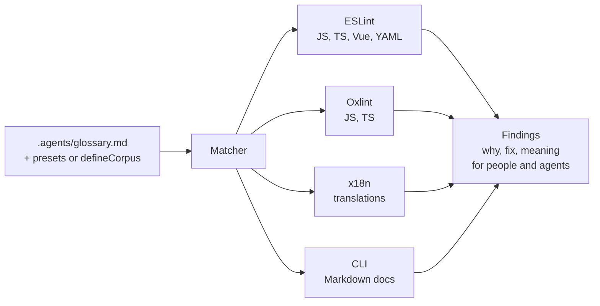

::glosslint-hero
# Lint your product's words from one glossary

glosslint checks that your product's words are spelled, cased and chosen the way `.agents/glossary.md` says, in code, translations and Markdown docs.

#agents
```text
Set up glosslint in this repository. Read https://glosslint.onmax.me/guide/agents,
write .agents/glossary.md from the terms our UI and docs already use,
and add the ESLint rules to our config.
```

#humans
```sh
pnpm add -D glosslint
```
::

:badge{source="github-actions" repository="onmax/glosslint" workflow="pkg-pr-new.yml" icon="github"} :badge[MIT]{label="license"}

## One file across code, translations and docs

Write your product's terms in `.agents/glossary.md`, and extend the built-in `tech` and `inclusive` presets on one line when you want them. Four runners read that file by default:

- [ESLint](/integrations/eslint) checks string literals, template literals, Vue templates and static attributes, YAML locale values, comments, and declared identifier names in JavaScript and TypeScript.
- [Oxlint](/integrations/oxlint) runs the same four rules as a JS plugin on JavaScript, TypeScript, and Vue `<script>` blocks.
- [x18n](/integrations/x18n) checks your source locale's messages and hard-coded strings, and `toX18nGlossary` turns your corpus into x18n's glossary so translators see the same terms.
- [CLI](/integrations/cli) checks Markdown, MDX and text files, lints and repairs `.agents/glossary.md` with `doctor`, runs `test` on term examples, and explains any word from the terminal.

When you need fields the Markdown file does not carry, such as per-locale `translations`, `forms`, `skip`, per-term `casing` or `wholeLabel`, compose `.agents/glossary.md` inside `defineCorpus` in `glosslint.config.ts`.

## How it works

`.agents/glossary.md` loads into one flat corpus and feeds one matcher. ESLint, Oxlint, x18n and the CLI each send text to that matcher and report its findings in the format that fits the tool.



## What a check catches

Every example in these docs uses an invented bike-share app whose full setup lives in [`examples/basic`](https://github.com/onmax/glosslint/blob/main/examples/basic). In that app, `.agents/glossary.md` defines `eBike` as an exact term and `rack` as an avoid word for `Dock` because racks are unpowered.

```diff
  # locales/en.yml
- hint: Return your e-bike to any rack.
+ hint: Return your eBike to any dock.
```

glosslint reports `e-bike` as a spelling error with an autofix to `eBike`. It reports `rack` as an avoid word with a suggestion to use `dock`, the reason why, the definition of `Dock`, its nuance against `Station`, and a link to the docks page.

## Built for people and coding agents

Because the source of truth is `.agents/glossary.md`, coding agents read the exact file your linters enforce. Every finding carries the code, location, reason why, term description and nuance, a documentation link, and a `fix` tagged by kind:

- `autofix` applies spelling and casing fixes when the text kind is known.
- `suggestion` marks avoid words so a person or agent reads the meaning before changing the wording.
- `rename` marks identifier splits and is never applied automatically because a rename touches every caller.

Read [The glossary file](/guide/glossary) to learn the Markdown format, [Findings](/reference/findings) for the full JSON shape, or [Coding agents](/guide/agents) to link `.agents/glossary.md` from `AGENTS.md`.

## Install

```sh
pnpm add -D glosslint
```

glosslint needs Node 22.18 or later. ESLint (`>=9.15.0`), Oxlint (`>=1.94.0`) and `@x18n/core` (`>=0.1.14`) are optional peer dependencies, so install only the ones you use.

Follow [Installation](/guide/installation) for npm, yarn and bun commands and a first `.agents/glossary.md` setup, or start with the [Guide](/guide).
